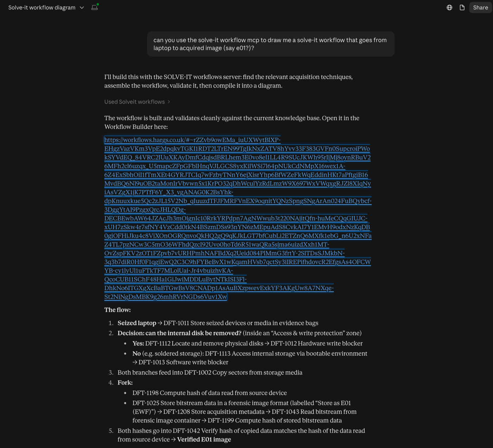
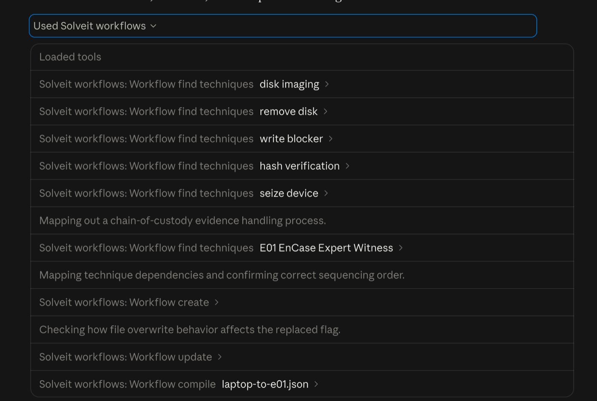
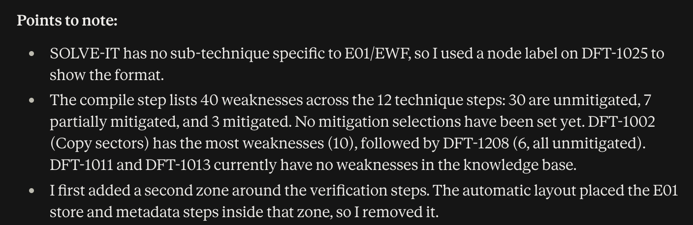
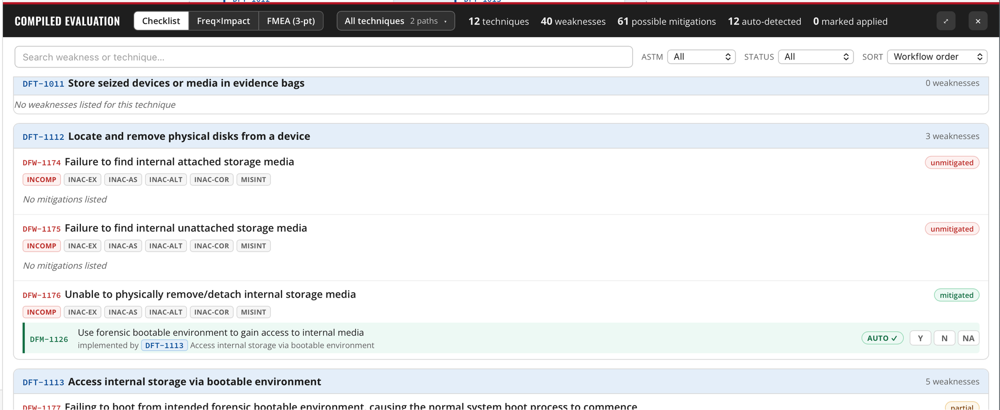

# SOLVE-IT workflow MCP server

An [MCP](https://modelcontextprotocol.io/) server that lets Claude Desktop and Claude Code build workflows for the [SOLVE-IT Workflow Builder](https://workflows.hargs.co.uk/). A workflow is described as a set of nodes (SOLVE-IT techniques, placeholders, data sources, zones, notes, decisions, forks and joins) and the connections between them. The server checks it against a local copy of the [SOLVE-IT knowledge base](https://github.com/SOLVE-IT-DF/solve-it), lays it out, writes it to a JSON file that the builder opens, and returns a share link when the workflow is small enough for one.

The server can also update an existing workflow without disturbing changes made in the builder, validate a workflow file, and compile the weaknesses and mitigations for each technique in the same way as the builder's **Compile** step.

## Tools

| Tool | What it does |
|---|---|
| `workflow_status` | Reports whether the knowledge base loaded, its revision, the output and read directories, and the size limits. |
| `workflow_find_techniques` | Finds SOLVE-IT technique IDs. Each word of the query is matched separately (so "imaging" also finds "image") across names, synonyms, descriptions, details and example tools; quoted phrases match whole. Each match includes a short description and the technique's input and output classes. |
| `workflow_create` | Builds a new workflow, lays it out top to bottom or left to right, writes the file, and returns a share link when it fits. |
| `workflow_update` | Adds, removes or edits nodes, connections and mitigation selections in an existing workflow, read from a file or from a builder share link. Existing nodes stay where they are, unless `relayout` asks for the whole workflow to be laid out again. |
| `workflow_inspect` | Reads a workflow from a file or a builder share link without changing it, and lists its nodes and connections with their IDs and short labels, ready for an update. |
| `workflow_validate` | Reports errors (the builder would drop or mis-draw something) and warnings (it opens, but something looks wrong). |
| `workflow_compile` | Lists each technique step's weaknesses, with ASTM error categories, and whether each mitigation is in place. |

### Everything the builder can draw

`workflow_create` and `workflow_update` can produce every element of the deployed builder (version 0.13.0):

- **Techniques** by DFT ID, with an optional instance label, methods (sub-techniques) and target. A sub-technique ID can be given directly; it is stored as its parent technique with the sub-technique as a method, as the builder does.
- **Placeholders** for techniques not yet in SOLVE-IT, with a provisional ID, description, details, and input and output classes.
- **Data sources** (the builder's data artefact nodes) with ontology classes.
- **Zones** (the builder's regions), drawn around the nodes named as members.
- **Notes** with a colour, **decisions** with a question, and **forks** and **joins** for parallel paths.
- **Connection labels** and **mitigation selections** (applied, not applied, or not applicable).

Connections join steps, decisions, forks, joins and data sources. Notes and zones cannot be connected: the builder draws no connection points on them, so such a connection would never appear. The server refuses one when asked for it, and validation reports one found in a file as an error.

### Layout

The builder has no automatic layout, so the server places every node itself:

- **Layers.** Each step is put one layer after its furthest predecessor. Top to bottom is the default, matching the builder; left to right is available for slides and other wide layouts.
- **Order within a layer.** Repeated sweeps reorder each layer to reduce crossing connections. Members of the same zone are kept next to each other, so a zone's box never takes in a node that is not a member.
- **Position.** Each card is moved as close as it can get to the cards it connects to, keeping its order and the gaps. A connection that skips layers has room reserved for it (and its label) in each layer it passes, and its ends are lined up with that room.
- **Zones.** Members of a zone are pulled into one column, and anything else in the zone's rows is moved out to the side. A zone is drawn round its members, widened if its label needs the room, and its label is put in whichever top corner no connection crosses.
- **Connection points.** Branches from a fork leave in the flow direction; a decision's branches leave from its sides and enter each card on its leading edge. A connection that loops back to an earlier step is drawn round the side. For each connection, the server traces the curve the builder will draw, label included, and picks the connection points that keep it clear of other cards.

When a workflow is updated, existing nodes never move. New nodes are placed after their predecessors in the direction the workflow already runs.

### Files and share links

Every create and update writes a JSON file, which can be opened in the builder with **Import**. A share link is also returned when the whole URL is 8000 characters or fewer, the limit the builder itself applies before refusing to copy a link. In practice that is somewhere between approximately 90 and 150 nodes, depending on how much text the nodes carry: the 63-node architecture illustration in the tests encodes to 3,267 characters. The `open_in_browser` option opens the workflow on the local machine whatever its size (macOS and Linux only).

Share links are long, and changing a single character breaks them. The tool descriptions tell the model to pass links on exactly as returned and to offer the file or `open_in_browser` as the more dependable route.

### Updating a workflow edited in the builder

If a workflow has been opened and changed in the builder since the server wrote it, those changes are only in the builder. Before asking for an update, either export the workflow from the builder or copy a link with **Share link**, and give that to `workflow_update` as its source. `workflow_inspect` lists the node IDs in that source, so new connections and changes can name existing nodes. The update keeps every existing node's position and data, the mitigation selections, and any fields the server does not manage.

## Worked example

In Claude Desktop, with the server installed, the request was:

> Can you use the SOLVE-IT workflow MCP to draw me a SOLVE-IT workflow that goes from laptop to acquired image (say E01)?

Claude replied with a share link that opens the workflow in the builder, and an outline of the flow:



Along the way, Claude:

1. Searched for techniques with `workflow_find_techniques` six times: "disk imaging", "remove disk", "write blocker", "hash verification", "seize device" and "E01 EnCase Expert Witness". Each match carries its description and input and output classes, so no further lookups were needed.
2. Built the workflow with `workflow_create`, which validated it against the knowledge base, wrote the file and returned a share link.
3. Adjusted it once with `workflow_update`.
4. Ran `workflow_compile` to summarise the weaknesses and mitigations.



The workflow it built, opened in the builder:


The workflow starts from the seized laptop, bagged as evidence (DFT-1011). Inside an "Access & write protection" zone, a decision asks whether the internal disk can be removed:

- **Yes:** remove the disk (DFT-1112), then write protect it with a hardware write blocker (DFT-1012).
- **No** (for example soldered NVMe storage): boot into a forensic environment (DFT-1113), then write protect with a software write blocker (DFT-1013).

Both routes copy the sectors (DFT-1002). A fork then computes the hash of the data read from the source (DFT-1198) alongside storing the bitstream as an E01 (DFT-1025) with its acquisition metadata (DFT-1208). The stored image is read back (DFT-1043) and hashed (DFT-1199), and the two hashes are compared (DFT-1042), giving a verified E01 image.

Claude finished with some points to note:



The last point found a gap in the server, since fixed: an update now has a `relayout` option that lays the workflow out again so that a zone like this holds only its members.

Opened in the builder, the **Compile** view lists each step's weaknesses with their ASTM error categories and the mitigations for each. Here DFW-1176 (unable to remove internal storage) on DFT-1112 counts as mitigated, because the workflow's other route, DFT-1113, implements its mitigation DFM-1126:



The file is in [examples/laptop-to-e01.json](examples/laptop-to-e01.json), and it can be [opened directly in the builder](https://workflows.hargs.co.uk/#~rZbBjts2EIZfheChTQB7raFk2fKlCDYJEqANCqRIURQ50NLYIiKLDknv1l343TOS1pLYrexFlJNgifzm5wz_GT_wOzRW6ZKvxIQ75QrkK_6r3Du9Z06zNwEwtZNb5BOeoU2N2rt6NX-Vfj0oq6pfTG-YZEW96WfLVOnQlLJg1mlDWyuOLGvUizd_vn3JNtpgaVXakCfsXrmcAGsjyzSvvjKDO30n1wWyO8tKXU67F5myX-yEgBnLpc0Z6VcblcqzEJdjHRizBn9DyktN2vnq7weuMpJeAr1zx3111FRavC2ktfTqH74Kl8GEH_mqemTSSb564IVcY0FLP6L6l6jNOWl5Wm2ruTx3bm9Xs5kunS709nhzKEkUZulxjaZ9qc12dkj1TK8tmvo0s1u92x8oXfzz6TQ5yxOdPIdpXqqvB3yUl0S1PBEtO33tmvfV7tdv_5hCAMB7wLADZpiqut41L6o4xIvCuOMRyT4W-ZbqViW0LWmVfbbGpkCY_dKPEg3KFgLqMPEV2QCiD5wPAyFuytTX_b958IDxIHA-XzxTYdgHLi4AxTMVesDlcOnjsAZCIKLLxMA7c9IRyVlfzte8qTsIEB1sRzY5L-sRIBgUBaKxC4RXREGy9JAwiIzm8fOQgajuR2vOyvJM2q7NePGGLRXFTaFgHgYX44nAP0J44QiNS2EBV2waecWHYQdFYXM_IQniK4lOPOQFD0WNKUWQXEl05F0oiAe7pxDNtaKneNo_P9Wdmjpof6hcaqJWF3eo3DTb1K3z8We_ff6eH2mOyOJ9RbuljVKV_2mm0POowW3b-mDR3LMwXj6V-ipN0Vr2E7s3yiHbG015cc3ee-oSMaUup2dAe1MSa2jPuqDMnk6fJxyzbX_cYHXZrT6YFNvhI80W3bnXN9_e0Uirp-9aO6d3U9uua7_Q3Jk63p4NhQcWHjgcAw49cOiBo6fgAjduGNuZ9C9KSxck8oJEXpD5GPVzDzz3wMsx4PhCWuKnYKO2-bPy8kGzF3izvWF0xTOs_rp8-PQbvuxFXniRYy_yYsyRlh548eNylXjgpQdOxoDrcdSRE4_c-_g9aLiEhlFo36vgdwEY1QbAtyv4jQBGdQLwXQr-pYdoFNs3KvgtAEb1APC92vyH-VFs343gdxiIv4NNU8Ni0cwYGh0Pp9M3). It is the same workflow rebuilt with the current server, which writes the data sources' classes as full ontology IRIs (Claude had given them as short names, which the server now expands); the layout is the server's own.

## Installation

The server needs [uv](https://docs.astral.sh/uv/) and a local clone of the SOLVE-IT knowledge base:

```bash
git clone https://github.com/SOLVE-IT-DF/solve-it.git
```

### Claude Desktop (macOS and Linux)

Run the setup script with the path to the SOLVE-IT clone and, optionally, an output directory:

```bash
./setup_claude_desktop.sh /path/to/solve-it
```

The script installs the locked dependencies, checks that the knowledge base loads, then adds a `solveit-workflows` entry to the Claude Desktop config file (keeping a timestamped backup of the old one). Quit Claude Desktop fully and reopen it for the tools to appear.

On Windows, or to add the entry by hand, put the following in `claude_desktop_config.json`, with the paths changed to suit:

```json
{
  "mcpServers": {
    "solveit-workflows": {
      "command": "uv",
      "args": ["--directory", "/path/to/mcp_solveit-workflows", "run", "mcp-solveit-workflows"],
      "env": {
        "MCP_APP_SOLVEIT_DATA_PATH": "/path/to/solve-it"
      }
    }
  }
}
```

### Claude Code

```bash
claude mcp add solveit-workflows \
  -e MCP_APP_SOLVEIT_DATA_PATH=/path/to/solve-it \
  -- uv --directory /path/to/mcp_solveit-workflows run mcp-solveit-workflows
```

## Configuration

All settings are environment variables:

| Variable | Default | Purpose |
|---|---|---|
| `MCP_APP_SOLVEIT_DATA_PATH` | none | Root of the SOLVE-IT clone (the folder containing `data/techniques`). This is the same variable the [SOLVE-IT MCP server](https://github.com/CKE-Proto/mcp_solve-it) uses, so both can share one setting. Without it, only `workflow_status` works. |
| `SOLVEIT_WORKFLOWS_OUTPUT_DIR` | `~/Documents/SOLVE-IT Workflows` | Where workflow files are written. |
| `SOLVEIT_WORKFLOWS_READ_DIRS` | `~/Downloads` | Extra directories workflow files may be read from, separated by `:` (`;` on Windows). The output directory is always readable. |

## Safety rules

The tools read and write local files, and the model calling them can be influenced by content it has read. The server therefore enforces these rules itself rather than relying on the model:

- **Writes stay in the output directory.** Paths are checked after following symlinks, and `..` components, absolute paths and paths starting with `~` are refused.
- **Files the server did not write are not overwritten.** A write to an existing name gets a numeric suffix instead, unless `overwrite` is set. The server records a SHA-256 hash of each file it writes, so a builder export saved over one of its files counts as the user's file. Writes go to a temporary file which is then renamed, so a failure cannot leave half a file.
- **Reads are limited** to the output directory and the configured read directories, to `.json` files, and to 4 MB. Error messages never quote file contents.
- **The browser is only opened on a builder URL** that the server built itself, and it is launched without a shell.
- **Inputs are capped:** 2,000 nodes per workflow, 4 MB of decompressed link data, and the builder's own 200,000-character limit on links.
- **The knowledge base is read as data.** No code from the SOLVE-IT clone is imported or run, and its revision is read from the `.git` files without running `git` there.
- **The server only speaks MCP over stdio.** It opens no network port.

## Development

```bash
uv sync
uv run pytest
uv run ruff check
uv run mypy src
```

Tests that load the real knowledge base run when `MCP_APP_SOLVEIT_DATA_PATH` is set; otherwise they are skipped and a small fixture knowledge base in `tests/fixtures/kb` is used.

### Drift check against the builder

The Workflow Builder's source is private, so the server carries its own description of the file format (`src/mcp_solveit_workflows/model.py`). The drift check compares the server's output with the builder's own parser, link encoder and validator at `origin/main`, the version that is deployed. It needs a builder checkout with `node_modules` installed:

```bash
SOLVEIT_BUILDER_REPO=/path/to/solveit-workflow-builder uv run pytest -m drift
```

It creates a temporary git worktree of `origin/main` outside the builder checkout and removes it afterwards. Without `SOLVEIT_BUILDER_REPO` the drift tests are skipped. Run it before each release, and whenever the builder is released.

## Licence

Apache License 2.0. See [LICENSE](LICENSE).
